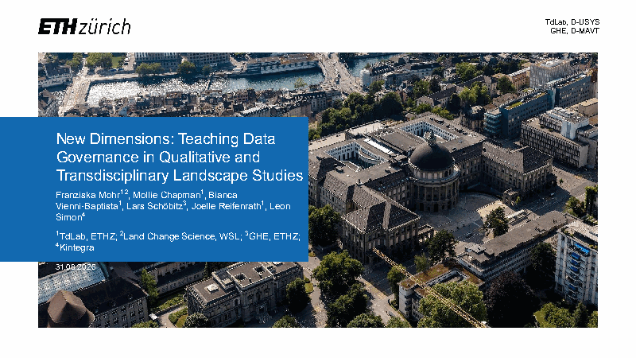
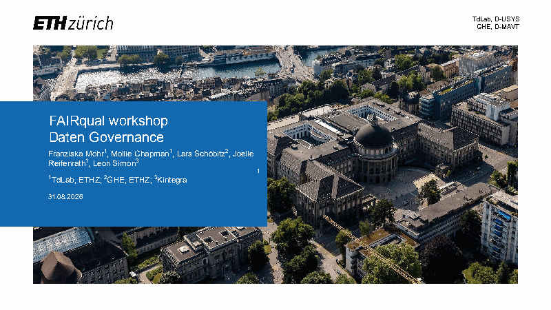
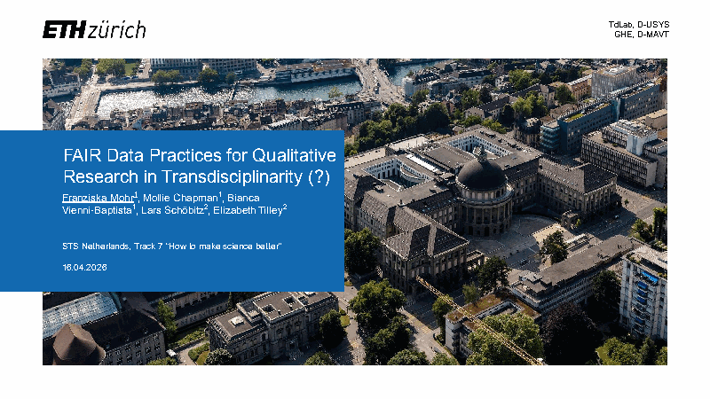

::: {.fq-hero}
::: {.fq-section}

# FAIR data practices for qualitative research in transdisciplinarity

<p class="fq-lead">FAIRqual explores how to make FAIR data practices part of qualitative data management in transdisciplinary research. Qualitative data raises ethical and confidentiality questions that make open sharing hard, yet shared data can help researchers learn from each other's projects. We run workshops and expert interviews and build technical workflows for sharing qualitative data.</p>

::: {.fq-actions}
[Explore outputs & data](outputs/index.qmd){.btn .btn-primary}
[See the slides](gallery/slides/index.qmd){.btn .btn-outline}
:::

:::
:::

::: {.fq-section}

## E-learning course

::: {.fq-feature}
::: {.fq-feature-text}
**Qualitative Data Governance for Transdisciplinary and Participatory Research** is our e-learning course, published on 30 September 2026 as a module of the ETH Domain Data Management Campus. It teaches shared data governance, an approach from the USYS TdLab at ETH Zurich that applies the FAIR principles to qualitative data in transdisciplinary research. Stakeholders and practice partners take part at every stage, from the design of a project to the archiving of its data, so data management runs through the whole project from the start.

::: {.fq-actions}
[Take the course on OpenLearnity](https://courses.openlearnity.org/learning/course/course-v1:ETH_domain+qualitative+datagovernance/home){.btn .btn-primary}
:::

[All outputs & data](outputs/index.qmd){.fq-more}
:::

::: {.fq-feature-media}

```{=html}
<video controls preload="metadata" playsinline poster="outputs/media/elearning-intro-poster.jpg" aria-label="Introduction video of the e-learning course">
<source src="outputs/media/elearning-intro.mp4" type="video/mp4">
<a href="https://doi.org/10.5281/zenodo.21809352">Watch the introduction video on Zenodo</a>
</video>
```

<p class="fq-credit">Introduction video by the ETH Domain Data Management Campus, FAIRqual (USYS TdLab, ETH Zurich) and ATOY Studio, licensed CC BY 4.0. Archived on Zenodo: <a href="https://doi.org/10.5281/zenodo.21809352">10.5281/zenodo.21809352</a>.</p>

:::
:::

:::

::: {.fq-tint}
::: {.fq-section}

## Slides

<p class="fq-lead">Talks and workshops where we presented FAIRqual.</p>

```{=html}
<div class="fq-cards">
<a class="fq-card" href="gallery/slides/index.qmd#pecsrl-2026"><div class="fq-card-body"><span class="fq-card-kicker">September 2026, Ghent</span><strong>PECSRL 2026: New Dimensions: Teaching Data Governance in Qualitative and Transdisciplinary Landscape Studies</strong><p>The FAIRqual project and the e-learning course, in a session on educating landscape geographers.</p></div></a>
<a class="fq-card" href="gallery/slides/index.qmd#jurapark-2026"><div class="fq-card-body"><span class="fq-card-kicker">August 2026, workshop</span><strong>FAIRqual Workshop 2026: Data Repositories und Mehr</strong><p>A data governance workshop in German, with the workshop deck, the input slides and a handout.</p></div></a>
<a class="fq-card" href="gallery/slides/index.qmd#sts-nl-2026"><div class="fq-card-body"><span class="fq-card-kicker">April 2026, University of Twente</span><strong>STS NL 2026: FAIR Data Practices for Qualitative Research in Transdisciplinarity</strong><p>How data governance and FAIR data practices in qualitative research could help make science better.</p></div></a>
</div>
```

[All slides](gallery/slides/index.qmd){.fq-more}

:::
:::

::: {.fq-section}

## Blog

<p class="fq-lead">News and reflections from the project.</p>

::: {#latest-posts}
:::

[All posts](blog/index.qmd){.fq-more}

:::

::: {.fq-band}
::: {.fq-band-inner}

## Get in touch

If you have questions about FAIRqual or about sharing qualitative data in your own project, write to Mollie Chapman at [mollie.chapman@usys.ethz.ch](mailto:mollie.chapman@usys.ethz.ch?subject=FAIRqual request). You can follow our work on [GitHub](https://github.com/fairqual).

:::
:::
